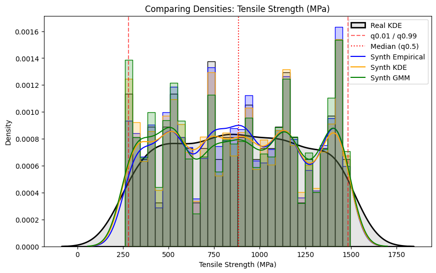

# Tensile Strength (MPa) - Distribution Comparison

**Purpose:** Compare the synthesized density of `Tensile Strength (MPa)` across the top 3 best-performing models against the exact empirical data. Overlaid KDEs and quantile bounds (q0.01, q0.5, q0.99).

**Interpretation:**
The vertical dashed lines indicate the extreme 1st and 99th percentiles of the real structural dataset. The colored histograms reflect the top three models overlapping the black dataset. Notice any distributions that fall noticeably flat or lack complete modality in areas of dense structure.

**Practical Implication:**
If synthetic distributions miss a modal peak or fail to reach the q99 bounds, those models should not be deployed in stress testing environments for that parameter.
