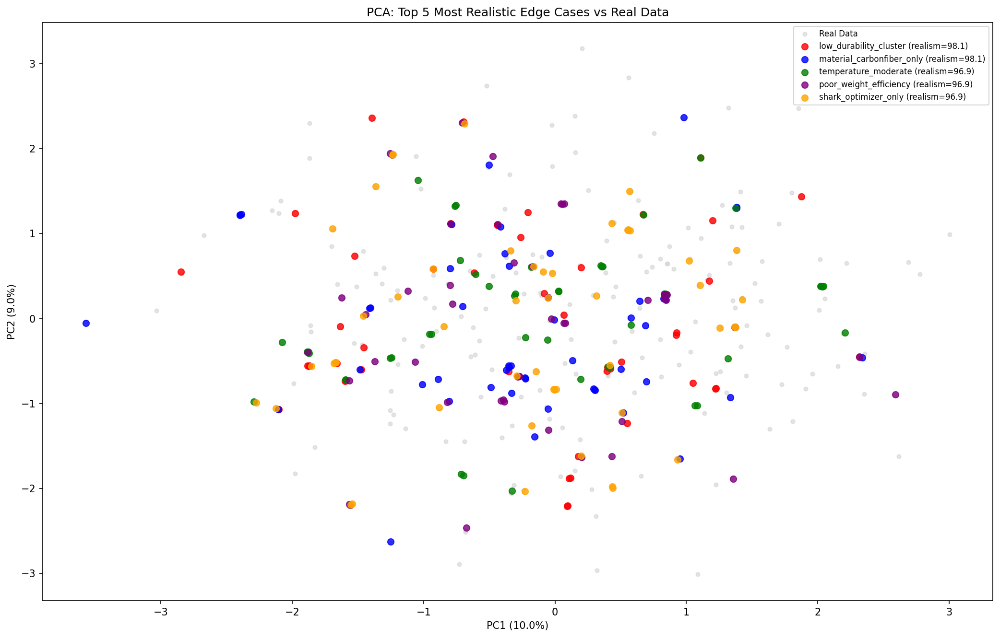

# Edge Case Stress Test Report — Aerospace Structural Design
*Business & Engineering Framing*

## Executive Summary

This report presents **27 stress test scenarios** representing rare but physically
plausible edge cases in aerospace structural design. Each scenario targets a specific
variable or configuration at its extreme — simulating conditions a structure might
encounter during its operational lifetime but which are underrepresented in the
nominal design dataset.

**Why edge cases matter in aerospace:**
- Aircraft certification requires demonstrating safety at operating extremes
- Failure mode analysis requires understanding tail-risk scenarios
- Predictive maintenance depends on identifying signatures of structural degradation
- Design optimization must avoid creating structures optimized only for nominal conditions

## Edge Case Overview

| Category | Scenarios | Avg Realism Score |
|---|---|---|
| Target | 4 | 93.3 |
| Material | 8 | 91.1 |
| Flight Envelope | 6 | 93.0 |
| Optimization | 4 | 87.2 |
| Lifecycle | 2 | 94.8 |
| Geometry | 4 | 83.9 |

## Realism Validation

Edge cases are validated by three criteria:
1. **Isolation Forest (IF):** IF anomaly % should be higher than the nominal ~5%,
   confirming the edge case rows are rare relative to the real data distribution.
2. **LOF (Local Outlier Factor):** Confirms local neighbourhood rareness.
3. **NN Distance:** Measures how far synthetic edge case rows are from their nearest
   real data point. Lower = more physically realistic; very high = hallucinated.

## Most Realistic Edge Cases

| Rank | Scenario | Realism Score | Description |
|---|---|---|---|
| 1 | low_durability_cluster | 98.1 | All Low-Durability configurations. Identifies input feature patterns associated ... |
| 2 | material_carbonfiber_only | 98.1 | Carbon Fiber-only structure set. Highest specific stiffness — primary flight str... |
| 3 | temperature_moderate | 96.9 | Temperature near mean (-50 degrees C). Nominal cruise temperature band.... |
| 4 | poor_weight_efficiency | 96.9 | All Poor Weight Efficiency rows. Overweight structural designs — candidates for ... |
| 5 | shark_optimizer_only | 96.9 | Shark Optimizer algorithm only. Nature-inspired metaheuristic mimicking shark pr... |
| 6 | operational_life_long | 96.3 | Operational life 37-39 years. Long-service aircraft requiring enhanced fatigue a... |
| 7 | wingspan_extreme_large | 95.7 | Wing span >56 m. Wide-body or UAV with high aspect ratio — maximum bending momen... |
| 8 | altitude_extreme_high | 95.7 | Altitude at 95th percentile (>17,500 m). Simulates stratospheric flight above co... |
| 9 | material_aluminum_only | 95.7 | Aluminum-only structure set. Lower density but lower strength — budget aerospace... |
| 10 | high_durability_cluster | 95.1 | All High-Durability configurations. Best-case scenario for structural longevity ... |

## Applications

1. **Fatigue Analysis:** The `operational_life_long` scenario (37+ years) tests structural
   longevity predictions — essential for Extended Service Life (ESL) certification.
2. **Extreme Environment Certification:** The `altitude_extreme_high` and
   `temperature_extreme_cold` scenarios support DO-160 environmental qualification.
3. **Weight Optimization:** The `poor_weight_efficiency` cluster identifies which
   input configurations drive overweight designs, directing optimization effort.
4. **Material Selection:** The material-specific clusters enable per-material
   durability analysis, supporting material down-selection decisions.
5. **Algorithm Benchmarking:** The optimization scenario clusters enable
   algorithm-specific convergence analysis under identical structural conditions.

---
*Edge Case Report — Aerospace Synthetic Data Project*