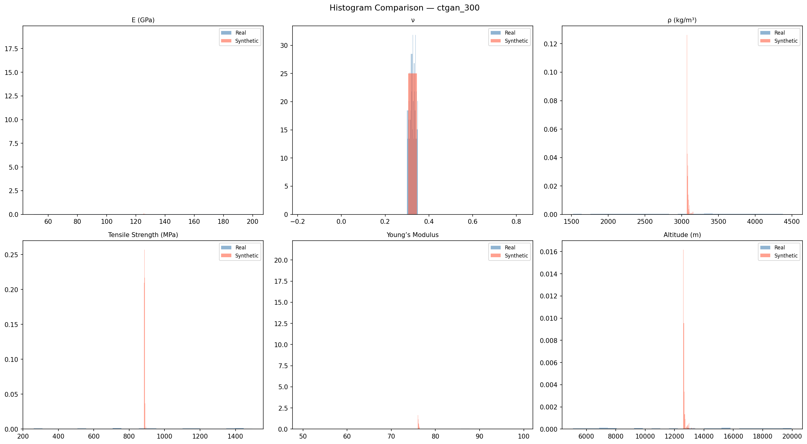
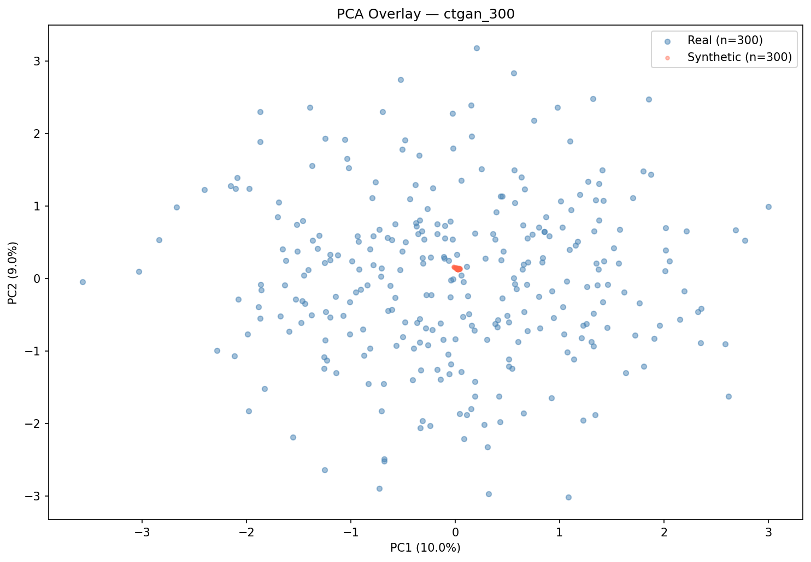
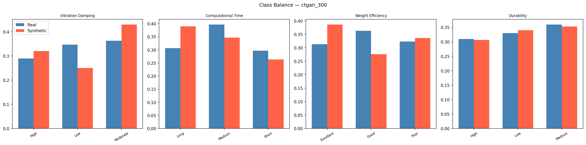

# Validation Report: ctgan_300
*Generated: 2026-03-17 23:13:07*

## Table of Contents
1. [Tier 1 — Minimum Bar](#tier-1--minimum-bar)
2. [Tier 2 — Statistical Fidelity](#tier-2--statistical-fidelity)
3. [Tier 2 — ML Utility (TSTR/TRTS)](#tier-2--ml-utility)
4. [Tier 2 — Rare Case Realism](#tier-2--rare-case-realism)
5. [Tier 2 — Overall Similarity](#tier-2--overall-similarity)
6. [Class Balance](#class-balance)
7. [Conclusion](#conclusion)

---

## Tier 1 — Minimum Bar

**Overall Tier 1 Result: ✅ PASS**

| Check | Status | Detail |
|---|---|---|
| Schema Match (22 columns) | ✅ | Expected 22 cols, got 22.  |
| Null Values | ✅ | 0 null values |
| Numeric Range Compliance | ✅ | All within real-data bounds |
| Categorical Level Validity | ✅ | All levels valid |
| Row Count (≥ 300) | ✅ | 300 rows |
| Class Degeneracy Check | ✅ | All classes populated |
| Duplicate Rows (informational) | ✅ | 0 duplicates (0.0%) |

---

## Tier 2 — Statistical Fidelity

| Metric | Value | Interpretation |
|---|---|---|
| KS Pass Rate | 0.0 | Fraction of features with KS p-value > 0.05 |
| Mean KS p-value | 0.0 | Higher = more similar distributions |
| Mean KL Divergence | 17.1008 | Lower = better (0 = identical) |
| Mean Wasserstein Distance | 0.8624 | Lower = better (normalized) |
| Mean JS Divergence | 0.6071 | Lower = better (0–1 bounded) |
| Correlation Frobenius Norm | 2.4304 | Lower = better (0 = identical) |

### Per-Feature KS Test Results

| Feature | KS Statistic | p-value | Pass (p > 0.05) |
|---|---|---|---|
| E (GPa) | 0.5000 | 0.0000 | ❌ |
| ν | 0.5067 | 0.0000 | ❌ |
| ρ (kg/m³) | 0.5000 | 0.0000 | ❌ |
| Tensile Strength (MPa) | 0.5000 | 0.0000 | ❌ |
| Young’s Modulus | 0.5000 | 0.0000 | ❌ |
| Altitude (m) | 0.5000 | 0.0000 | ❌ |
| Temperature (°C) | 0.5000 | 0.0000 | ❌ |
| Pressure (Pa) | 0.5000 | 0.0000 | ❌ |
| Operational Life (years) | 0.4867 | 0.0000 | ❌ |
| Wing Span (m) | 0.5000 | 0.0000 | ❌ |
| Fuselage Length (m) | 0.5000 | 0.0000 | ❌ |
| Structural Thickness (mm) | 0.5000 | 0.0000 | ❌ |
| Number of Iterations | 0.5000 | 0.0000 | ❌ |
| Optimization Time (sec) | 0.5000 | 0.0000 | ❌ |

---

## Tier 2 — ML Utility

### TSTR (Train on Synthetic, Test on Real)

| Target | Accuracy | Macro F1 |
|---|---|---|
| Vibration Damping | 0.3167 | 0.2929 |
| Computational Time | 0.28 | 0.2737 |
| Weight Efficiency | 0.3233 | 0.318 |
| Durability | 0.3333 | 0.3329 |
| **Mean** | **0.3133** | **0.3044** |

### TRTS (Train on Real, Test on Synthetic)

| Target | Accuracy |
|---|---|
| Vibration Damping | 0.43 |
| Computational Time | 0.4833 |
| Weight Efficiency | 0.37 |
| Durability | 0.3533 |
| **Mean** | **0.4092** |

### Feature Importance Alignment (FI-MAE)
Lower MAE = synthetic data learned the same physical rules as real data.

| Target | FI-MAE |
|---|---|
| Vibration Damping | 0.0174 |
| Computational Time | 0.0259 |
| Weight Efficiency | 0.0203 |
| Durability | 0.0269 |
| **Mean** | **0.0226** |

---

## Tier 2 — Rare Case Realism

| Metric | Value | Target |
|---|---|---|
| Isolation Forest Anomaly Rate | 0.0% | ~5% |
| Mean Distance to Real Anomalies | None | Lower = more realistic |
| NN Distance Mean | 2.5252 | Lower = closer to real |
| NN Distance Median | 2.5259 | |
| NN Distance P95 | 2.5354 | |

---

## Tier 2 — Overall Similarity

| Metric | Value | Interpretation |
|---|---|---|
| MMD Score | 0.999396 | Lower = more similar (0 = identical) |
| Discriminator AUC | 1.0 | Near 0.5 = indistinguishable from real |
| GMM Log-Likelihood | -13.8417 | Higher = more plausible |

---

## Class Balance

### Chi-Square Test (Synthetic vs Real Distribution)

| Target | Chi² Statistic | Degrees of Freedom |
|---|---|---|
| Vibration Damping | 12.6873 | 2 |
| Computational Time | 9.8078 | 2 |
| Weight Efficiency | 11.5157 | 2 |
| Durability | 0.1387 | 2 |

---

## Conclusion

**Dataset:** ctgan_300
**Overall Grade:** F
**Verdict:** ❌ **DOES NOT MEET MINIMUM BAR** — This dataset should not be used.

### Key Metrics Summary
- TSTR Mean Accuracy: **0.3133** (benchmark: >0.85 = excellent)
- KS Pass Rate: **0.0000** (benchmark: >0.80 = excellent)
- Mean FI-MAE: **0.0226** (benchmark: <0.01 = excellent)
- Discriminator AUC: **1.0000** (benchmark: <0.6 = excellent)
- MMD Score: **0.999396** (benchmark: <0.1 = excellent)

---
*Report generated by the Aerospace Synthetic Data Validation Pipeline v2.0*