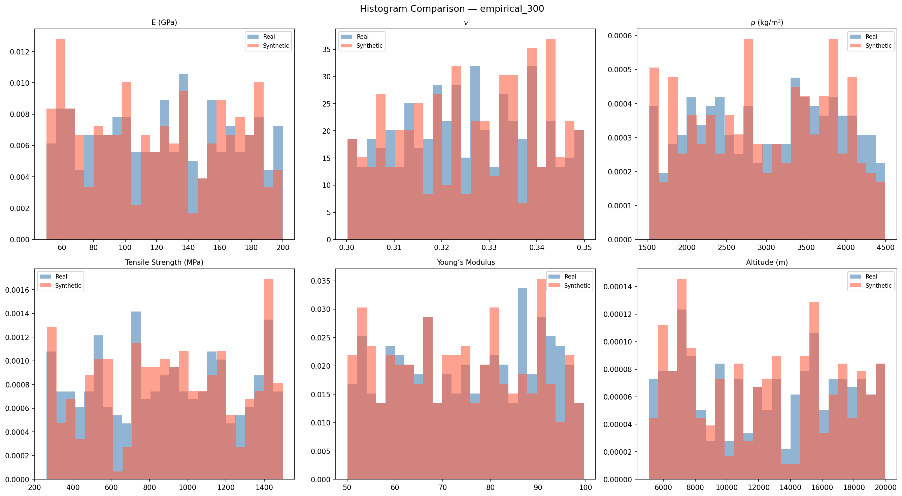
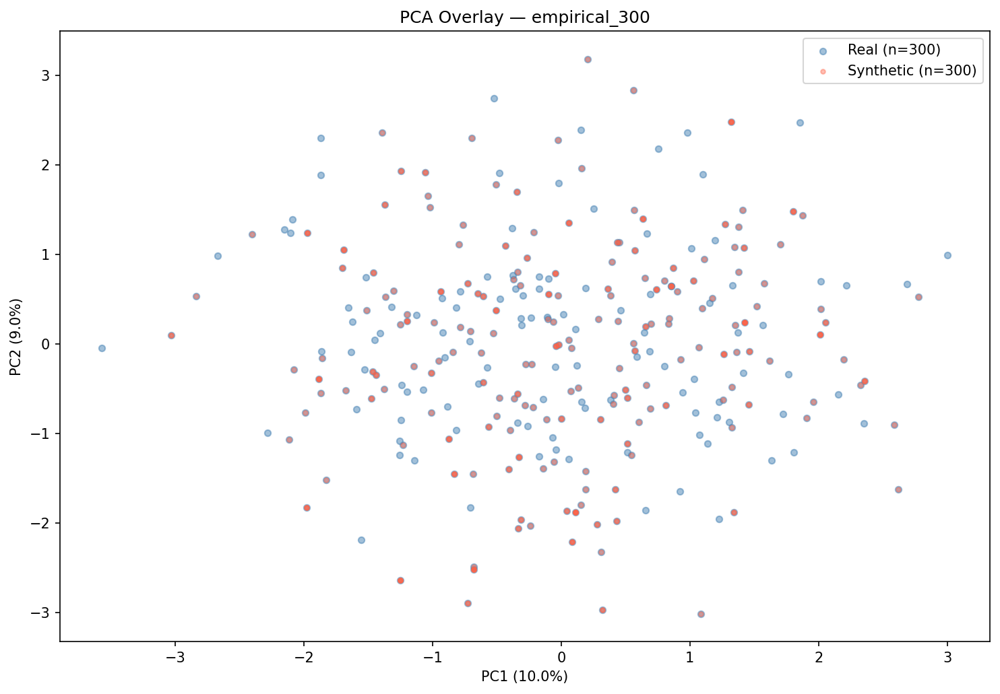
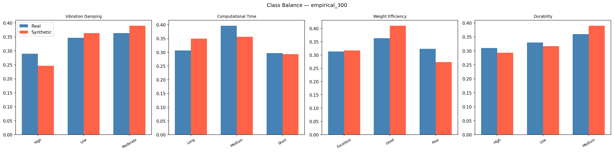

# Validation Report: empirical_300
*Generated: 2026-03-17 23:13:38*

## Table of Contents
1. [Tier 1 — Minimum Bar](#tier-1--minimum-bar)
2. [Tier 2 — Statistical Fidelity](#tier-2--statistical-fidelity)
3. [Tier 2 — ML Utility (TSTR/TRTS)](#tier-2--ml-utility)
4. [Tier 2 — Rare Case Realism](#tier-2--rare-case-realism)
5. [Tier 2 — Overall Similarity](#tier-2--overall-similarity)
6. [Class Balance](#class-balance)
7. [Conclusion](#conclusion)

---

## Tier 1 — Minimum Bar

**Overall Tier 1 Result: ✅ PASS**

| Check | Status | Detail |
|---|---|---|
| Schema Match (22 columns) | ✅ | Expected 22 cols, got 22.  |
| Null Values | ✅ | 0 null values |
| Numeric Range Compliance | ✅ | All within real-data bounds |
| Categorical Level Validity | ✅ | All levels valid |
| Row Count (≥ 300) | ✅ | 300 rows |
| Class Degeneracy Check | ✅ | All classes populated |
| Duplicate Rows (informational) | ✅ | 111 duplicates (37.0%) |

---

## Tier 2 — Statistical Fidelity

| Metric | Value | Interpretation |
|---|---|---|
| KS Pass Rate | 1.0 | Fraction of features with KS p-value > 0.05 |
| Mean KS p-value | 0.8379 | Higher = more similar distributions |
| Mean KL Divergence | 0.1006 | Lower = better (0 = identical) |
| Mean Wasserstein Distance | 0.0652 | Lower = better (normalized) |
| Mean JS Divergence | 0.0133 | Lower = better (0–1 bounded) |
| Correlation Frobenius Norm | 0.8223 | Lower = better (0 = identical) |

### Per-Feature KS Test Results

| Feature | KS Statistic | p-value | Pass (p > 0.05) |
|---|---|---|---|
| E (GPa) | 0.0567 | 0.7221 | ✅ |
| ν | 0.0600 | 0.6536 | ✅ |
| ρ (kg/m³) | 0.0400 | 0.9705 | ✅ |
| Tensile Strength (MPa) | 0.0567 | 0.7221 | ✅ |
| Young’s Modulus | 0.0700 | 0.4549 | ✅ |
| Altitude (m) | 0.0367 | 0.9879 | ✅ |
| Temperature (°C) | 0.0433 | 0.9414 | ✅ |
| Pressure (Pa) | 0.0500 | 0.8483 | ✅ |
| Operational Life (years) | 0.0333 | 0.9964 | ✅ |
| Wing Span (m) | 0.0467 | 0.9003 | ✅ |
| Fuselage Length (m) | 0.0500 | 0.8483 | ✅ |
| Structural Thickness (mm) | 0.0367 | 0.9879 | ✅ |
| Number of Iterations | 0.0500 | 0.8483 | ✅ |
| Optimization Time (sec) | 0.0500 | 0.8483 | ✅ |

---

## Tier 2 — ML Utility

### TSTR (Train on Synthetic, Test on Real)

| Target | Accuracy | Macro F1 |
|---|---|---|
| Vibration Damping | 0.7267 | 0.7211 |
| Computational Time | 0.7433 | 0.7406 |
| Weight Efficiency | 0.7533 | 0.7511 |
| Durability | 0.7667 | 0.7663 |
| **Mean** | **0.7475** | **0.7448** |

### TRTS (Train on Real, Test on Synthetic)

| Target | Accuracy |
|---|---|
| Vibration Damping | 1.0 |
| Computational Time | 1.0 |
| Weight Efficiency | 1.0 |
| Durability | 1.0 |
| **Mean** | **1.0** |

### Feature Importance Alignment (FI-MAE)
Lower MAE = synthetic data learned the same physical rules as real data.

| Target | FI-MAE |
|---|---|
| Vibration Damping | 0.004 |
| Computational Time | 0.0073 |
| Weight Efficiency | 0.0054 |
| Durability | 0.0049 |
| **Mean** | **0.0054** |

---

## Tier 2 — Rare Case Realism

| Metric | Value | Target |
|---|---|---|
| Isolation Forest Anomaly Rate | 6.67% | ~5% |
| Mean Distance to Real Anomalies | 0.0 | Lower = more realistic |
| NN Distance Mean | 0.0 | Lower = closer to real |
| NN Distance Median | 0.0 | |
| NN Distance P95 | 0.0 | |

---

## Tier 2 — Overall Similarity

| Metric | Value | Interpretation |
|---|---|---|
| MMD Score | 0.006543 | Lower = more similar (0 = identical) |
| Discriminator AUC | 0.3116 | Near 0.5 = indistinguishable from real |
| GMM Log-Likelihood | -18.374 | Higher = more plausible |

---

## Class Balance

### Chi-Square Test (Synthetic vs Real Distribution)

| Target | Chi² Statistic | Degrees of Freedom |
|---|---|---|
| Vibration Damping | 2.7701 | 2 |
| Computational Time | 3.0583 | 2 |
| Weight Efficiency | 4.1284 | 2 |
| Durability | 1.1804 | 2 |

---

## Conclusion

**Dataset:** empirical_300
**Overall Grade:** B
**Verdict:** ⚠️ **CONDITIONAL PASS** — Acceptable for analysis but not production.

### Key Metrics Summary
- TSTR Mean Accuracy: **0.7475** (benchmark: >0.85 = excellent)
- KS Pass Rate: **1.0000** (benchmark: >0.80 = excellent)
- Mean FI-MAE: **0.0054** (benchmark: <0.01 = excellent)
- Discriminator AUC: **0.3116** (benchmark: <0.6 = excellent)
- MMD Score: **0.006543** (benchmark: <0.1 = excellent)

---
*Report generated by the Aerospace Synthetic Data Validation Pipeline v2.0*